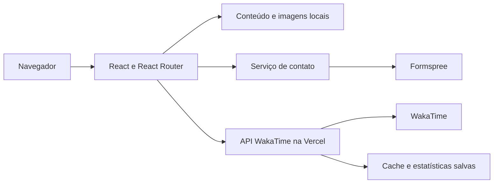
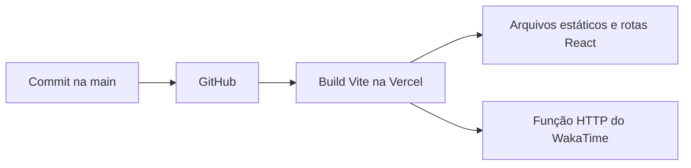
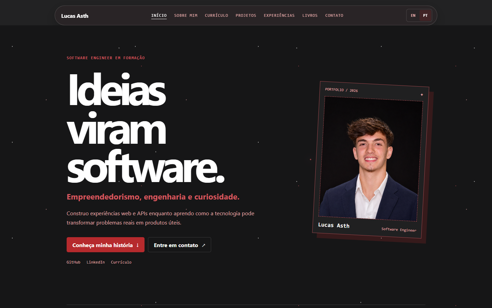
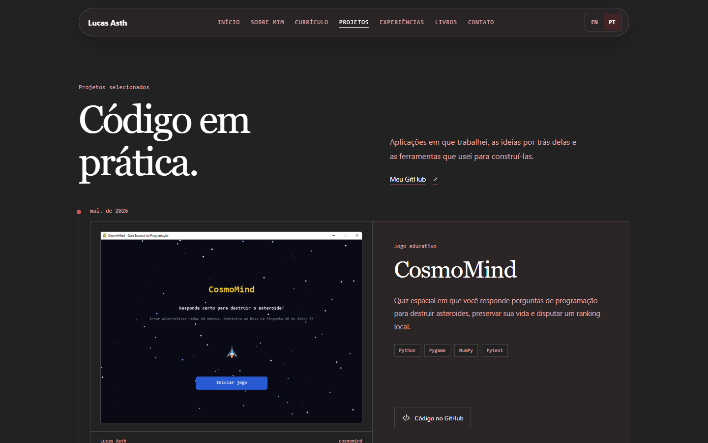
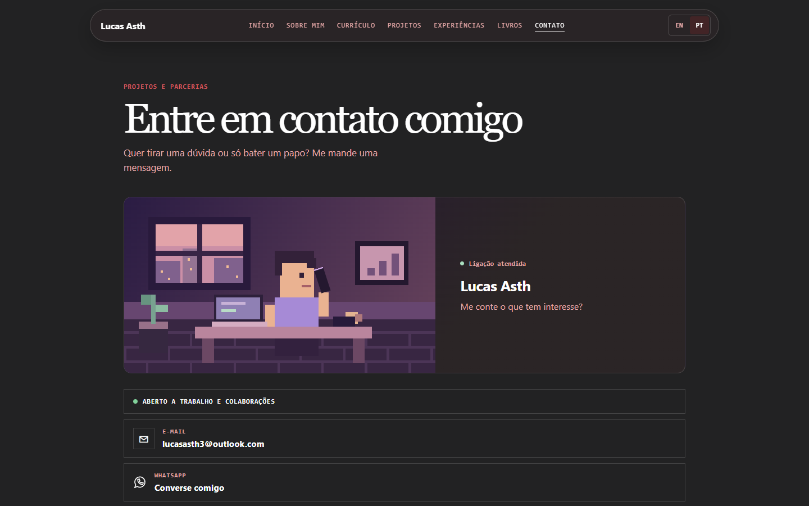
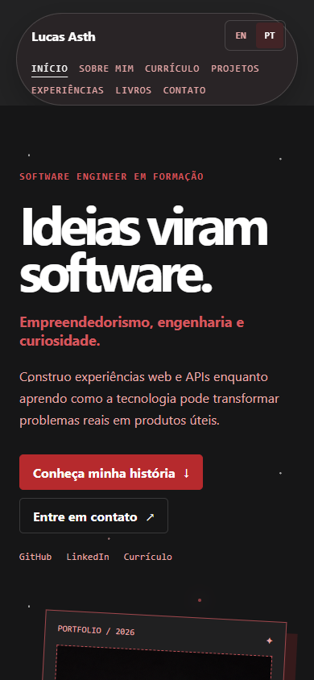

<!-- Documentação adaptada do template do Prof. Dr. João Paulo Aramuni. -->

---

# 🏷️ Portfólio Profissional — Lucas Asth 👨‍💻

> [!NOTE]
> Formação, experiências e projetos reunidos em um portfólio **bilíngue, responsivo e publicado na nuvem**.

<table>
  <tr>
    <td width="800">
      <div align="justify">
        Portfólio de <b>Lucas Asth</b>, estudante de Engenharia de Software na PUC Minas. O site apresenta minha trajetória, os projetos em que trabalhei e as ferramentas utilizadas, além de oferecer contato por e-mail e WhatsApp. Foi desenvolvido com <b>React e Vite</b> para o Trabalho Prático 1 de Portfólio Profissional, com conteúdo em português e inglês e hospedagem na Vercel.
      </div>
    </td>
    <td align="center">
      
    </td>
  </tr>
</table>

---

## 🚧 Status do Projeto

[](https://portfolio-lucasasth.vercel.app)


[](https://github.com/Lucasasth3/Portfolio-LucasAsth/commits/main)

Site publicado, com documentação visual local e wireframes no Figma. As telas do Figma não estão conectadas; a navegação funcional é demonstrada no site.

---

## 📚 Índice

- [Links Úteis](#links-uteis)
- [Sobre o Projeto](#sobre-o-projeto)
- [Funcionalidades Principais](#funcionalidades-principais)
- [Tecnologias Utilizadas](#tecnologias-utilizadas)
- [Arquitetura](#arquitetura)
- [Instalação e Execução](#instalacao-e-execucao)
- [Deploy](#deploy)
- [Estrutura de Pastas](#estrutura-de-pastas)
- [Demonstração](#demonstracao)
- [Testes](#testes)
- [Documentações utilizadas](#documentacoes-utilizadas)
- [Autores](#autores)
- [Contribuição](#contribuicao)
- [Agradecimentos](#agradecimentos)
- [Licença](#licenca)

---

<a id="links-uteis"></a>

## 🔗 Links Úteis

- 🌐 **Demo Online:** [acesse o portfólio](https://portfolio-lucasasth.vercel.app).
- 💻 **Código-fonte:** [repositório no GitHub](https://github.com/Lucasasth3/Portfolio-LucasAsth).
- 🎨 **Wireframes:** [arquivo no Figma](https://www.figma.com/design/J9LBsBqbds5wn447Rqflyo/Lucas-Asth-%E2%80%94-Portf%C3%B3lio-profissional).
- 📖 **Documentação visual:** [abrir o guia de wireframes e telas](docs/design/README.md).
- 🎤 **Apresentação:** [slides em PDF](docs/apresentacao/Apresentacao-Portfolio-Lucas-Asth.pdf).

---

<a id="sobre-o-projeto"></a>

## 📝 Sobre o Projeto

O portfólio reúne minha trajetória, formação em Engenharia de Software na PUC Minas e projetos em um único site. Foi desenvolvido para apresentar meu trabalho a professores, recrutadores e possíveis clientes, no contexto do Trabalho Prático 1 de Portfólio Profissional.

O objetivo é facilitar a consulta aos meus trabalhos e às minhas experiências, sem depender de informações espalhadas em redes e repositórios. Professores, recrutadores e possíveis clientes encontram o contexto de cada projeto, as tecnologias empregadas e os meios de contato.

A identidade visual utiliza fundo escuro, tons de vermelho, tipografia de destaque e um retrato interativo. O conteúdo é organizado por páginas e seções, com adaptação para celular.

---

<a id="funcionalidades-principais"></a>

## ✨ Funcionalidades Principais

- 🌐 **Apresentação bilíngue:** informações pessoais, interesses e objetivos em português e inglês.
- 🗓️ **Timeline de projetos:** ordenação dinâmica do mais antigo ao mais recente, com descrição, tecnologias, imagens e links disponíveis.
- 💼 **Formação e experiências:** instituições, atividades, períodos e descrições da trajetória.
- 📨 **Contato por e-mail:** formulário com validação e envio pelo Formspree, além de links para WhatsApp, LinkedIn e GitHub.
- 📚 **Leituras:** livros com capas e avaliações.
- 📊 **Atividade de programação:** estatísticas do WakaTime e visualizações de linguagens.
- 🎨 **Interações:** retrato com pintura em pixel e globo de habilidades.
- 📱 **Responsividade:** layout adaptado a telas menores e preferências de movimento reduzido.

As recomendações cadastradas na página de contato ficam somente no navegador que as salvou.

---

<a id="tecnologias-utilizadas"></a>

## 🛠 Tecnologias Utilizadas

### 💻 Front-end

- **Biblioteca:** React e React DOM.
- **Linguagem:** JavaScript com módulos ES.
- **Navegação:** React Router DOM.
- **Estilização:** CSS, SVG e Canvas para o retrato interativo.
- **Estado:** hooks e Context API para o idioma.
- **Build:** Vite e plugin React.

### 🖥️ Back-end e integrações

- **Runtime:** Node.js, com função HTTP na Vercel.
- **Endpoint:** `/api/wakatime`, responsável pela consulta de estatísticas e pelo cache.
- **E-mail:** Formspree, chamado pelo formulário de contato.
- **Dados:** arquivos locais para o conteúdo e estatísticas salvas; não há banco de dados próprio.
- **Credencial de leitura:** token do WakaTime mantido no servidor.

### 📱 Acesso mobile

O acesso em celular é feito pelo site responsivo, no navegador. Não há aplicativo nativo ou APK.

### ⚙️ Infraestrutura e ferramentas

- **Hospedagem:** Vercel.
- **Versionamento:** Git e GitHub.
- **Publicação:** integração entre a branch `main` e a Vercel.
- **Análise estática:** Oxlint.
- **Testes:** executor nativo do Node.js.

### Dependências e versões

| Dependência | Versão declarada | Uso |
| --- | --- | --- |
| React / React DOM | 19.3.1 | Componentes e renderização |
| React Router DOM | 7.18.5 | Navegação |
| Vite | 8.3.6 | Desenvolvimento e build |
| @vitejs/plugin-react | 6.1.2 | Integração React e Vite |
| Oxlint | 1.90.0 | Análise estática |
| @types/react / @types/react-dom | 19.3.0 | Definições de tipos |

As versões acima são as declaradas em [package.json](package.json). Os intervalos de atualização estão nesse arquivo; as versões resolvidas na instalação estão em [package-lock.json](package-lock.json).

---

<a id="arquitetura"></a>

## 🏗 Arquitetura

A interface utiliza React e React Router, com páginas compostas por componentes reutilizáveis. Os conteúdos ficam em `src/data`, separados das páginas. O contexto React centraliza o idioma.

O formulário envia dados ao Formspree pelo serviço de contato. A rota `/api/wakatime` consulta estatísticas no servidor e mantém o token fora do navegador, com cache dos últimos dados disponíveis. O portfólio não utiliza banco de dados próprio nem autenticação de visitantes.

### Componentes e responsabilidades

| Camada | Responsabilidade | Local |
| --- | --- | --- |
| Páginas | Compor as telas e as rotas | `src/pages` |
| Componentes | Reutilizar seções e elementos da interface | `src/components` |
| Conteúdo | Centralizar projetos, livros e dados do perfil | `src/data` |
| Serviços | Enviar e validar dados do contato | `src/services` |
| Utilitários | Ordenar e interpretar datas dos projetos | `src/utils` |
| Servidor | Consultar e preservar estatísticas do WakaTime | `api` e `server` |

Essa separação permite atualizar textos, projetos e livros sem alterar a navegação. A consulta do WakaTime no servidor evita expor sua credencial no navegador. A dependência de serviços externos exige tratamento de falhas: o contato mantém os campos quando o envio falha, e as estatísticas preservam os últimos dados disponíveis.

### Diagramas





---

<a id="instalacao-e-execucao"></a>

## 🔧 Instalação e Execução

### Pré-requisitos

Node.js 24, npm e Git.

### 📦 Instalação de Dependências

```bash
git clone https://github.com/Lucasasth3/Portfolio-LucasAsth.git
cd Portfolio-LucasAsth
npm ci
```

### 🔑 Variáveis de Ambiente

Copie [`.env.example`](.env.example) para `.env.local`, na raiz. Exemplo com valores de demonstração:

```dotenv
VITE_CONTACT_ENDPOINT=https://formspree.io/f/SEU_FORMULARIO
VITE_WHATSAPP_NUMBER=55DDNUMERO
WAKATIME_ACCESS_TOKEN=SEU_TOKEN_DE_LEITURA
WAKATIME_USERNAME=
WAKATIME_RANGE=all_time
```

Substitua os valores de demonstração pelos dados das suas integrações. Na Vercel, cadastre as mesmas variáveis em **Settings → Environment Variables**.

| Variável | Finalidade |
| --- | --- |
| `VITE_CONTACT_ENDPOINT` | Endpoint público do formulário |
| `VITE_WHATSAPP_NUMBER` | País, DDD e telefone, somente dígitos |
| `WAKATIME_ACCESS_TOKEN` | Token de leitura, exclusivo do servidor |
| `WAKATIME_USERNAME` | Perfil público opcional |
| `WAKATIME_RANGE` | Período consultado; padrão `all_time` |

As variáveis `VITE_` são públicas. Não coloque senhas ou tokens privados nelas. Reinicie o Vite após alterar o ambiente.

### ⚡ Como Executar a Aplicação

```bash
npm run dev
```

Abra `http://localhost:5173` e mantenha o terminal em execução. A porta é fixa: se estiver ocupada, o comando informa um erro. Se a aba estava aberta com o servidor parado, reinicie o servidor e atualize com `Ctrl+F5`.

```bash
npm run build
npm run preview
```

O build gera `dist`; o preview informa seu endereço no terminal.

### 📨 Configuração do Formulário e WhatsApp

Crie um formulário no Formspree, confirme o e-mail de destino e preencha `VITE_CONTACT_ENDPOINT` com o endpoint recebido. Preencha `VITE_WHATSAPP_NUMBER` com o telefone completo. Envie uma mensagem real e confirme seu recebimento, inclusive em spam.

O formulário envia nome, e-mail, assunto e mensagem por `FormData`. Em caso de falha, mantém os campos e oferece contato direto por e-mail.

### 📊 Configuração do WakaTime

Preencha `WAKATIME_ACCESS_TOKEN` com um token pessoal de leitura de [WakaTime OAuth](https://wakatime.com/oauth). A chave do plugin do editor não permite consultar estatísticas. As variáveis do WakaTime ficam no servidor, sem prefixo `VITE_`.

A rota `/api/wakatime` funciona no desenvolvimento, no preview e na Vercel. Retorna totais, linguagens e editores, sem nomes de projetos, arquivos ou máquinas. Os últimos dados válidos são preservados quando a consulta falha.

```bash
npm run sync:wakatime
```

Esse comando atualiza o registro incluído no build. Hospedagens exclusivamente estáticas utilizam `src/data/wakatimeSnapshot.json`; consultas atualizadas exigem a função HTTP.

---

<a id="deploy"></a>

## 🚀 Deploy

O projeto está publicado na Vercel como `portfolio-lucasasth`. A configuração utiliza o preset Vite, comando `npm run build` e saída `dist`. O arquivo `vercel.json` permite acessar diretamente rotas como `/projects` e `/contact`.

Envie os commits para a branch `main` no GitHub: a integração inicia o deploy automaticamente. Confira o resultado em **Deployments** na Vercel. Cadastre as variáveis de ambiente no painel; alterações nelas exigem um novo deploy. Não envie tokens ou `.env.local` ao GitHub.

Após publicar, confira o menu em computador e celular, o acesso direto às rotas, as imagens, o formulário e as estatísticas. O domínio personalizado `lucasasth.dev` é opcional e ainda depende de registro e DNS.

---

<a id="estrutura-de-pastas"></a>

## 📂 Estrutura de Pastas

```text
api/                    Função HTTP do WakaTime para Vercel
docs/
  design/               Wireframes, telas e prévia navegável
  readme/               Marca e capturas desta documentação
  apresentacao/         Slides em PDF
public/
  capas/ e covers/      Capas dos livros
  icons/                Ícones de tecnologias
  images/               Retratos e imagens dos projetos
scripts/                Atualização do registro do WakaTime
server/                 Consulta e cache das estatísticas
src/
  components/           Componentes e seções
  data/                 Conteúdo, links e estatísticas salvas
  pages/                Páginas do portfólio
  services/             Envio do formulário e testes
  utils/                Ordenação da timeline e testes
  Aplicacao.jsx         Rotas e estrutura principal
  ProvedorIdioma.jsx    Seleção de idioma
vite.config.js          Configuração de desenvolvimento e build
vercel.json             Configuração das rotas na hospedagem
```

Atualize os projetos em `src/data/projetos.js`. As datas de início usam `startedAt`, no formato `AAAA-MM-DD`. CalculaDOR utiliza 1º de julho de 2026 como referência aproximada. DoAção e CalculaDOR possuem repositórios privados: suas telas, descrições e tecnologias estão no portfólio, mas o código não é público. As capas dos livros estão relacionadas em `src/data/livros.js`.

---

<a id="demonstracao"></a>

## 🎥 Demonstração

### 🌐 Aplicação Web

Capturas reais do site publicado, registradas em 21 de novembro de 2026. Acesse a [aplicação na Vercel](https://portfolio-lucasasth.vercel.app) para testar as interações.

| Início | Projetos |
| :---: | :---: |
|  |  |

| Contato | Versão mobile |
| :---: | :---: |
|  |  |

### 🎨 Wireframes e Protótipos


O diretório `docs/design` contém 22 wireframes de média fidelidade e 22 telas visuais em SVG: 11 páginas e estados nas versões desktop (1440 px) e mobile (390 px). Inclui mapa de navegação e referência de estilos.

O [guia da documentação visual](docs/design/README.md) permite acessar as telas e o mapa de navegação pelo GitHub. Para usar a prévia interativa, clone ou baixe o repositório e abra `docs/design/index.html` no navegador, sem servidor. No VS Code, clique com o botão direito nesse arquivo, escolha **Revelar no Explorador de Arquivos** e abra-o com Chrome ou Edge. O GitHub exibe o código do HTML, não executa a prévia. Ela simula estados do formulário, sem enviar mensagens. Animações, busca de livros e serviços externos são referências estáticas.

O material documenta o site existente em 21 de novembro de 2026. O arquivo no Figma reúne wireframes das páginas principais e referências visuais. Ele não é um protótipo clicável; a navegação entre páginas deve ser demonstrada no site publicado. As versões completas em SVG e a prévia navegável estão em `docs/design`. As instruções estão no [guia da documentação visual](docs/design/README.md).

### 💻 Consulta da API

Com o servidor local em execução:

```bash
curl http://localhost:5173/api/wakatime
```

A resposta é um JSON com totais e linguagens disponíveis. O conteúdo depende das credenciais, do período configurado e dos últimos dados salvos.

### 🎤 Apresentação Final

Os [slides em PDF](docs/apresentacao/Apresentacao-Portfolio-Lucas-Asth.pdf) apresentam o objetivo, o design, a arquitetura, as funcionalidades e um roteiro para demonstrar o site ao vivo.

---

<a id="testes"></a>

## 🧪 Testes

### Testes Automatizados

```bash
npm test
```

Ferramenta: executor nativo do Node.js. Os arquivos [contato.test.js](src/services/contato.test.js) e [projetos.test.js](src/utils/projetos.test.js) verificam validação e envio do formulário, tratamento de falhas, formatação do WhatsApp e ordenação das datas dos projetos.

### Análise Estática e Build

```bash
npm run lint
npm run build
```

O Oxlint verifica o código e o Vite gera a versão de produção.

### Verificação de Interface

Confira as páginas em computador e celular, a troca de idioma, os links e as imagens. No formulário, confirme tanto a mensagem de sucesso quanto o recebimento por e-mail. Verifique também o acesso direto a rotas como `/projects` e `/contact` após atualizar o navegador.

Não há comando `test:e2e` configurado no projeto.

---

<a id="documentacoes-utilizadas"></a>

## 🔗 Documentações utilizadas

- [React](https://react.dev/).
- [React Router](https://reactrouter.com/).
- [Vite](https://vite.dev/guide/).
- [Node.js: testes](https://nodejs.org/api/test.html).
- [Vercel](https://vercel.com/docs).
- [Formspree](https://help.formspree.io/).
- [WakaTime API](https://wakatime.com/developers).

---

<a id="autores"></a>

## 👥 Autores

| Nome | Foto | GitHub | LinkedIn | E-mail |
| --- | :---: | --- | --- | --- |
| **Lucas Asth** |  | [Lucasasth3](https://github.com/Lucasasth3) | [Lucas Asth](https://www.linkedin.com/in/lucas-asth/) | [Contato](mailto:lucasasth3@outlook.com) |

Estudante de Engenharia de Software na PUC Minas e autor do portfólio.

---

<a id="contribuicao"></a>

## 🤝 Contribuição

Sugestões podem ser enviadas pelas issues do repositório. Para propor uma alteração, crie uma branch, descreva a mudança e execute testes, lint e build antes de abrir um pull request. Não inclua tokens ou arquivos de ambiente nas alterações.

---

<a id="agradecimentos"></a>

## 🙏 Agradecimentos

Documentação adaptada do [modelo de README do Prof. Dr. João Paulo Aramuni](https://github.com/joaopauloaramuni/desenvolvimento-e-integracao-de-aplicacoes-web/blob/main/TEMPLATES/template_README.md).

Os ícones em `public/icons` vêm do [Devicon](https://github.com/devicons/devicon), sob licença MIT.

---

<a id="licenca"></a>

## 📄 Licença

O repositório ainda não possui um arquivo de licença para o código do portfólio. Os recursos de terceiros permanecem sujeitos às respectivas licenças. Fotografias pessoais e capas de livros não recebem automaticamente a licença dos ícones.

---
